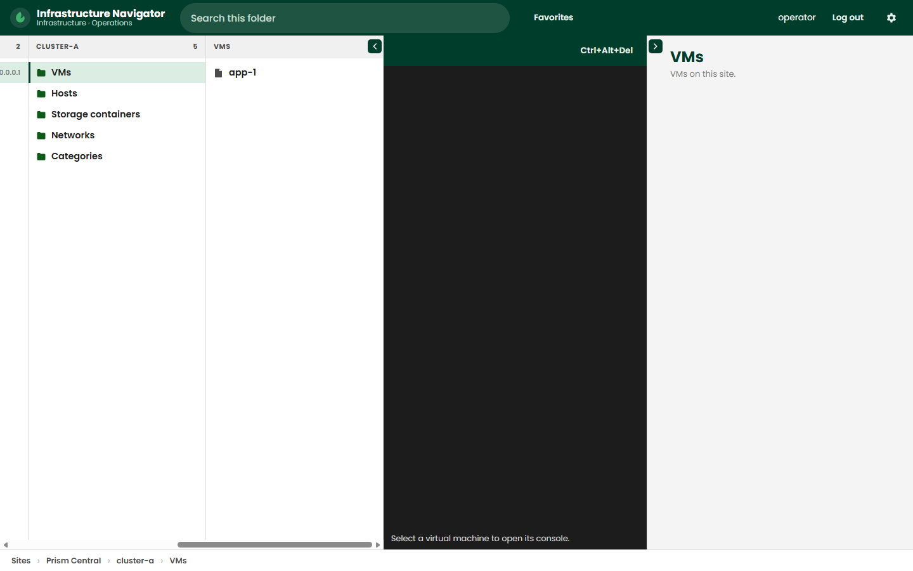

# Infrastructure Navigator

Read-only folder navigation for Prism Central. Sign in with a Prism Central address, then browse clusters, virtual machines, hosts, storage, networks, and categories.



## Run

```bash
npm install
npm test
npm start
```

The server listens on port 4173 unless `PORT` is set.

## Build id

The About menu reads `version-build`. The build id is `YYYY-MM-DD-NNN`, where `NNN` is how many commits were made that day.

## Container

```bash
docker run --rm -p 4173:4173 ghcr.io/script-repo/infra-nav:latest
```
