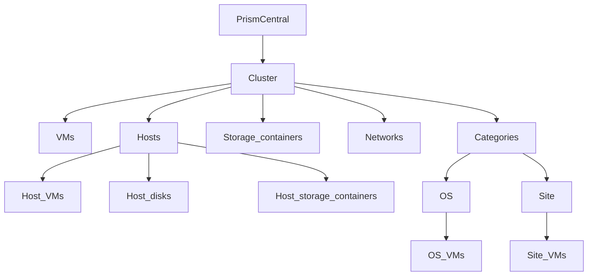

# Sobeys infrastructure navigation

Design specification for an art-of-the-possible proof of concept.

| | |
| --- | --- |
| Status | Proposal. Not a committed design, a Prism feature, or a production system. |
| Audience | Sobeys and Arctic, for review. |
| Evidence | Prism behavior below is limited to what Nutanix Remote Console Client (NRCC) already calls in `ntnx-console-client`. |
| Visual source | Retail grocery portal tokens and components in `008-cvlab-retail-grocery/cv-portal`. |

Labels used in this document:

- **Demonstrated** — present in NRCC against Prism Central. Cited so the POC can reuse a known read.
- **Proposal** — a POC design choice. Not a confirmed Sobeys requirement and not a delivery commitment.
- **Open question** — needs a decision or a confirmed API read before the folder can show live data.

This document does not assign an owner, a support model, an API-maintenance owner, or a delivery date. Those were raised by the team and are listed as open questions.

---

## 1. Purpose and framing

The POC explores a read-only navigation UI over infrastructure that Prism Central already manages. The UI is a folder tree that fans out. Prism itself stores categories as key/value pairs. It does not store this tree.

The tree is an application projection:

- Prism Central and cluster folders come from a cluster list.
- The cluster **VMs** folder comes from the AHV VM list, grouped by cluster.
- **Categories > OS** and **Categories > Site** come from category values already attached to VMs.
- Hosts, disks, storage containers, networks, and host-scoped VMs are folders in the UI. NRCC does not contain a navigation read for them, so this spec does not name an endpoint. Until a read is confirmed on the target Prism Central, those folders render empty and say they are not bound in this build.

Two clusters illustrate scale. Both labels are fictional:

- A medium-large cluster in Atlantic Canada, with three nodes.
- A small-format cluster in Western Canada, with one node.

Nothing in this spec is a native Prism view, a Prism plugin, or a production operations console.

---

## 2. User goals and workflows

### Goals

A reviewer can:

1. Sign in to one Prism Central and see it as the root folder.
2. Expand that root and see the clusters it manages, including the two example clusters when they are registered to that PC.
3. Expand a cluster and see its child folders at the same time: VMs, Hosts, Storage containers, Networks, and Categories.
4. Open **VMs** and see the VMs on that cluster, with name, power state, and addresses when the VM list returns them.
5. Open **Categories** and fan out to **OS** and **Site**, then to one folder per category value, then to the VMs that carry that value.
6. See Hosts, Disks, Storage containers, and Networks as folders, and see an explicit unbound state where no read has been confirmed.
7. Tell, from the footer, that the screen is an art-of-the-possible POC and not a Prism feature.

The POC does not manage devices, change power state, edit categories, or open a console.

### Workflow: open the Atlantic Canada cluster

Proposed illustration, not a real store.

1. The user signs in to the Prism Central that manages the lab clusters.
2. The root folder is that Prism Central. Expanding it lists clusters.
3. The user expands the three-node Atlantic Canada cluster. Five sibling folders appear under it: VMs, Hosts, Storage containers, Networks, Categories.
4. **VMs** lists the VMs whose cluster reference is that cluster. Cards show name and power state. Address appears when the list payload includes one.
5. **Hosts** is visible. This build shows the unbound empty state unless a host list has been confirmed on that PC. The intended children, once bound, are one folder per host, and under each host the folders VMs, Disks, and Storage containers.
6. **Categories** expands to **OS** and **Site**. **Site > Atlantic Canada** lists VMs tagged with that Site value. **OS** lists one folder per OS value actually present on those VMs. This spec does not invent OS names.

### Workflow: open the Western Canada cluster

Same path, against the one-node small-format cluster.

1. The user expands the Western Canada cluster under the same Prism Central.
2. The same five sibling folders fan out.
3. **VMs** lists that cluster’s VMs.
4. **Hosts** is present. A bound host list would show one host, then that host’s VMs, Disks, and Storage containers. Until the read is confirmed, the folder uses the unbound empty state.
5. **Categories > Site > Western Canada** lists VMs tagged with that Site value.

### Workflow: compare the two clusters

The user collapses one cluster and expands the other. The tree keeps both cluster folders under the same Prism Central so the three-node shape and the one-node shape can be compared without leaving the screen. Search filters cards in the folder that is open. It does not search unbound folders, because those folders have no rows.

### What “done” feels like in a review

The reviewer can walk both clusters, see live VMs, see OS and Site groupings when those category values exist on the VMs, and see every other requested folder without the UI pretending it has loaded hosts, disks, containers, or networks.

---

## 3. Navigation and screens

Expanding a folder reveals its children in place, under the parent. The parent stays on screen. The UI does not swap the whole page for the next level.

Banner, province, and four-digit store code are not levels in this tree. Location is **Categories > Site > VMs**. Whether a Site value is a region, a province, or a store code is an open question. The POC illustrations use `Atlantic Canada` and `Western Canada` as proposed Site values. NRCC’s category-value rules reject spaces and several punctuation characters and cap a value at 64 characters, so those two labels may need a different spelling before they can be stored as category values. See open questions.

### Tree

| Folder | What expands under it | Data in this POC |
| --- | --- | --- |
| Prism Central | One folder per cluster | Demonstrated cluster list. One signed-in PC is the root. NRCC has no directory of many Prism Centrals. |
| Cluster | VMs, Hosts, Storage containers, Networks, Categories | Cluster identity from the cluster list. Display name is shown when the payload includes one. NRCC’s cluster listing today keeps the id, not a separate name field, so the name is a proposal on top of that payload. |
| VMs | VM cards, no further folders | Demonstrated VM list, grouped onto the cluster. |
| Hosts | One folder per host | Unbound. NRCC’s host calls are Prism Element v1, v2, and v3, and they exist to recover a CVM identity, not to build this tree. |
| Host | VMs, Disks, Storage containers | Unbound. The VM normalizer does not keep a host reference, so host-scoped VMs are unbound even though cluster VMs are not. |
| Host > Disks | Disk cards | Unbound. No disk read in NRCC. |
| Host > Storage containers | Container cards | Unbound. Distinct from the cluster Storage containers folder. How the two lists relate is an open question. |
| Storage containers | Container cards | Unbound. No storage-container read in NRCC. |
| Networks | Network cards | Unbound. No network read in NRCC. |
| Categories | OS, Site | UI structure. Only these two subfolders in the POC. |
| OS | One folder per `OS` category value | Demonstrated category entries on VMs, grouped in the app. |
| OS > value | VM cards | VMs whose categories include that `OS` value. |
| Site | One folder per `Site` category value | Same pattern. |
| Site > value | VM cards | VMs whose categories include that `Site` value. |

A VM with no `OS` value still appears under the cluster **VMs** folder. It does not appear under **OS**. The same rule applies to **Site**.

### Screens

**Sign-in.** Proposed. Prism Central address, username, and password. An explicit control allows self-signed TLS, matching the lab behavior NRCC already needs. Credentials are sent to the POC backend. The browser does not call Prism.

**Tree and content.** After sign-in, one page holds the folder tree and the open folder’s cards.

- The tree shows Prism Central expanded far enough to show cluster folders.
- Expanding a cluster fans out VMs, Hosts, Storage containers, Networks, and Categories as sibling rows.
- Expanding Hosts fans out each host, and expanding a host fans out VMs, Disks, and Storage containers.
- Expanding Categories fans out OS and Site. Expanding either fans out one row per category value.
- The content pane shows cards for the selected folder. Selecting a folder-only node (a cluster, Hosts, Categories, OS, Site) shows a short lead and the child folders; it does not invent object cards.
- Selecting VMs, a Site value, or an OS value shows VM cards.
- Selecting an unbound folder shows the empty state and no synthetic rows.

**VM card.** Name, power-state badge, and address when present. Controller VM and hidden VM flags may be shown when the list marks them, because NRCC already reads those flags. Selecting a card opens the detail modal.

**VM detail modal.** Name, UUID, power state, addresses, and the category entries returned for that VM. Cluster id is shown when the VM detail read returns `cluster.extId` or the legacy cluster reference. No host, disk, container, or network block is shown as live data.

**Unbound folder.** The folder remains in the tree. The content pane states that this folder is not bound in this build. It does not show sample hosts, disks, containers, or networks.

**Empty bound folder.** A bound folder with zero rows (for example, no VM carries `OS`) uses the same empty visual treatment and says there is nothing in this folder. That message is different from the unbound message.

**Failure.** If Prism Central cannot be reached, or the VM or cluster list fails, the tree stays visible and the content pane shows the error text returned to the backend. The POC does not retry forever and does not fall through to invented inventory.

The Android MDM UI was the original analogy for a store-style drill-down. It has not been reviewed, and it does not define this tree or this visual design.

---

## 4. Visual design

The POC uses the retail grocery portal’s design system. It does not introduce a second palette and it does not imitate Prism chrome.

Source files:

- Tokens: `008-cvlab-retail-grocery/cv-portal/assets/theme.css` (the cv-lab frontend copy is the same token set).
- Components: `008-cvlab-retail-grocery/cv-portal/assets/styles.css`, as used by `cv-portal/index.html`.

The CSS comment names a style-guide markdown file. That file is not in the grocery repo. The CSS files are the implemented source. The POC links `theme.css` and reuses the component patterns below. It does not reuse the computer-vision catalogue content.

### Tokens

| Role | Token | Value |
| --- | --- | --- |
| Header, footer, primary button, open folder | `--brand-green` | `#003D2A` |
| Link, button hover | `--brand-green-logo` | `#0E5A19` |
| Eyebrow, expand marker | `--brand-green-fresh` | `#3EB36C` |
| Tint, focus ring, “on” badge | `--brand-green-tint` | `#E6EFEA` |
| Page background | `--brand-bg` | `#F4F4F4` |
| Hero, notes | `--brand-cream` | `#E9E3D2` |
| Cards, inputs | `--brand-white` | `#FFFFFF` |
| Body text | `--brand-ink` | `#1E1E1E` |
| Card titles | `--brand-ink-2` | `#313131` |
| Secondary text | `--brand-grey-700` to `--brand-grey-100` | `#4C4C4C`, `#7A7A7A`, `#C4C4C4`, `#DCDCDC`, `#F0F0F0` |

Accents already defined in the portal, and used only the way that portal uses them (a card accent or a warning tint, not a new status language): cyan `#00D6FF`, orange `#EF9300`, magenta `#BB008E`, purple `#A554FB`, red `#D44325`, pink `#FD9EB3`.

Type is Poppins for body text. Headings use `--font-display` (`Retail-Supermarket-Grocery Sans`, then Poppins) in `--brand-green`. Radius is pill, 24px, 12px, and 5px. Shadows are `--shadow-sm`, `--shadow-card`, `--shadow-pop`, and `--shadow-modal`. The content column max width is 1240px. Spacing steps are 4, 8, 12, 16, 24, 32, 48, and 64px.

### How screens use the existing components

- **Header** (`.site-header`): sticky, 68px, `--brand-green`. Leaf mark, a wordmark, and a short subtitle. Proposed wordmark: “Infrastructure Navigator”. Proposed subtitle: “Art of the possible”. The chrome is required. The words are a proposal.
- **Hero** (`.hero`): cream band. Eyebrow, the open folder’s name, one line of description, and stat tiles for the children currently fanned out. Counts for unbound folders are omitted rather than shown as zero.
- **Folder tree:** the portal has no tree widget. Proposal: build one from these tokens. Rows sit on the page background. A `--brand-green-fresh` marker shows a folder can expand. The open row is filled `--brand-green` with white text. Children indent under the parent so the fan-out is visible without a page change. Collapsed folders hide their children. Folder rows and object cards stay visually distinct.
- **Breadcrumb:** the portal pill chips (`.chip`). The active segment is filled `--brand-green`.
- **Object cards** (`.grid` / `.card`): white, 12px radius, card shadow, 4px top border in `--brand-green`, slight lift on hover.
- **Search:** the portal search field. It filters cards in the open folder only.
- **Power badge:** `.badge.recorded` (green tint) when the VM list reports a powered-on state, `.badge.pending` (warm tint) for any other reported state. No new status colors. If the payload has no power state, the badge says the state is unknown and uses the pending treatment.
- **Detail:** `.modal-panel`, 24px radius, spec rows with green labels.
- **Footer** (`.site-footer`): deep green bar. The muted line states that this is an art-of-the-possible POC and not a Prism feature or a production console.
- **Empty and unbound:** `.empty` on the grey background. Unbound copy is “This folder is not bound in this build.”
- **Narrow viewport:** at 860px the header stacks and two-column layouts collapse to one column, matching the portal. The tree moves above the cards.

---

## 5. Data model and category-to-hierarchy mapping

Prism does not have folders. The POC keeps no second source of truth for inventory. It reads Prism and projects the tree.

### Objects the app holds

Proposed in-memory model for one session. Nothing here is written back to Prism.

| App object | Source | Fields this POC may show |
| --- | --- | --- |
| Session | User sign-in | Prism Central host, and credentials held by the backend for the session. Not stored in the browser past the session. |
| Cluster | Cluster list | Id (`extId`, or `id` / `uuid` / `metadata.uuid` when that is what the payload uses). Name only when the payload includes one. External address when the cluster detail read returns it. |
| VM | VM list, plus VM detail when a cluster id is missing from the list | UUID, name, power state, categories, IP addresses, hidden flag, controller-VM flag. Cluster id from `cluster.extId` or the legacy cluster reference on the detail read. |
| Category grouping | Derived | Key `OS` or `Site`, the value, and the VM ids that carry that pair. |
| Folder node | Derived | Parent, label, kind (bound object list, category grouping, or unbound). |

Host, disk, storage container, and network are folder nodes of kind unbound. They have no object rows in this build.

### What is stored in Prism versus composed in the app

| Tree level | Stored in Prism as | Composed by the app |
| --- | --- | --- |
| Prism Central | The PC the user connected to | The root folder |
| Cluster | A cluster entity | A folder under the root |
| VMs | AHV VM entities and their cluster reference | The folder membership |
| Hosts, disks, storage containers, networks | Not established for this UI | The folder chrome only |
| Categories > OS > value > VMs | Category key/value pairs on VMs | The folders and the grouping |
| Categories > Site > value > VMs | Category key/value pairs on VMs | The folders and the grouping |

NRCC normalizes categories from several payload shapes into `key:value` strings. The POC uses that same reading. It does not assume a single JSON shape.

### Category keys

Only the Categories branch is category-driven. VMs, Hosts, Storage containers, and Networks are object folders, not category paths.

Proposed keys, not a Sobeys standard:

| Key | Folder | Rule |
| --- | --- | --- |
| `OS` | Categories > OS > {value} > VMs | One child folder per distinct value. A VM appears under every `OS` value it actually carries. |
| `Site` | Categories > Site > {value} > VMs | Same rule. |

This spec does not encode a path inside one category value. NRCC’s beta VM folders do that with a reserved key, `NTNXFolderPath`, using dot-separated segments such as `Production.Linux.Web`. That pattern is prior art for “Prism has no folders.” It is not the model for OS and Site.

Proposed lab preparation, done in Prism before the demo, not by the POC:

- Create or reuse the `OS` and `Site` keys.
- Assign values on the VMs that should appear under those folders.
- Leave the POC read-only. NRCC shows that writing categories changes a catalog every Prism user can see.

Proposed Site values for the two illustrations: `Atlantic Canada` and `Western Canada`. Confirm the spelling against category character rules before relying on it. OS folders show only values present on the VMs. No OS names are specified here.

A cluster-level category, or a host-level category, is not part of this model. NRCC reads and writes categories on VMs. Whether clusters or hosts accept the same keys is an open question, and this POC does not depend on them doing so.

### Cluster membership

A VM belongs to the cluster folder whose id matches the VM’s cluster reference.

Demonstrated on VM detail: `GET /api/vmm/v4.x/ahv/config/vms/{uuid}` exposes `cluster.extId`, with legacy `clusterReference.uuid` / `cluster_uuid` also checked by NRCC.

Not established: whether every row of the VM list already includes that cluster id. NRCC’s list normalizer does not keep it. Proposal: use the cluster id from the list row when it is present, and otherwise resolve it from the VM detail read. VMs that still have no cluster id appear in a proposed “Cluster not resolved” group under the Prism Central root, not under a guessed cluster.

### Host membership

Not established. The folder **Hosts > {host} > VMs** requires a VM-to-host field this client does not read. Those folders stay unbound.

---

## 6. v4 API integration approach

### Where calls run

Proposal, following NRCC’s shape:

- The browser talks only to a small POC backend.
- The backend calls Prism Central at `https://{host}:9440` with HTTP Basic authentication.
- Each v4 call sends a new UUID in both `NTNX-Request-Id` and `X-Request-Id`. NRCC does this because some Prism builds validate one of the two headers.
- The backend probes v4.0, v4.1, and v4.2 for the cluster and VM lists, because NRCC already finds that the working version differs by build. It remembers the version that succeeded for the session.
- Lists page with `$page` and `$limit`. NRCC uses a page size of 100 for VMs.
- Self-signed TLS is rejected unless the user explicitly allows it at sign-in.
- The backend does not write categories, power state, or any other Prism object.

One Prism Central that already manages both example clusters is an assumption. It is not something NRCC’s API surface can discover. Clusters that are not registered to that PC are out of scope until Arctic confirms how those clusters are reached.

### Calls this POC may make

These are the reads NRCC already implements. Versions below are the ones NRCC probes. `v4.x` means v4.0, v4.1, and v4.2.

| Purpose | Call | Used for |
| --- | --- | --- |
| List clusters | `GET /api/clustermgmt/v4.x/config/clusters` with `$limit=100` on the first probes | Cluster folders under Prism Central |
| Cluster external address | `GET /api/clustermgmt/v4.x/config/clusters/{extId}` | Address on the cluster, from `network.externalAddress` and the other external-address fields NRCC already checks |
| List VMs | `GET /api/vmm/v4.x/ahv/config/vms` with `$page`, `$limit`, and `$includeHidden=true` when the build accepts it | Cluster VMs folder, and the VM pool for OS and Site grouping |
| VM cluster id | `GET /api/vmm/v4.x/ahv/config/vms/{uuid}` | Cluster folder membership when the list row has no cluster id |
| List category values | `GET /api/prism/v4.1/config/categories` and `GET /api/prism/v4.0/config/categories`, with `$filter=key eq '…'` when the build accepts it, otherwise an unfiltered page that the app filters | Optional. The POC can group OS and Site from the categories already on each VM. A category-catalog list is demonstrated in NRCC and is not required to draw the VM groupings. |

NRCC’s v3 fallbacks exist because some builds reject the v4 category list. They are demonstrated, and they are a fallback rather than the primary design:

- `POST` or `PUT /api/nutanix/v3/categories/{key}/list`

This POC does not call NRCC’s category create, VM category update, console-token, power, CVM, or Prism Element login APIs.

### Calls this POC must not invent

The following folders are in the UI. No navigation endpoint for them is specified here, because none is implemented in NRCC.

| Folder | Why it is unbound |
| --- | --- |
| Hosts, and each host | Host reads in NRCC are Prism Element only: `GET /PrismGateway/services/rest/v2.0/hosts`, `GET /PrismGateway/services/rest/v1/hosts`, and `POST /api/nutanix/v3/hosts/list`. They recover a controller VM identity. They are not a Prism Central host tree, and this POC does not adopt them as one. |
| Host > VMs | The VM normalizer does not keep a host reference. |
| Host > Disks | No disk read in NRCC. |
| Storage containers, at cluster or host scope | No storage-container read in NRCC. |
| Networks | No network read in NRCC. |

Confirming a read on the target Prism Central is an open question for Arctic. After a read is confirmed, the spec can name that call. Until then the folder stays unbound.

### Response fields the UI depends on

From the VM list, as NRCC already normalizes them:

- Identity: `extId`, else `id`, `uuid`, or `metadata.uuid`
- Name: `name` and the other name locations NRCC already checks
- Power: `powerState` and the status/spec locations NRCC already checks
- Categories: the category and `categories_mapping` locations NRCC already folds into `key:value`
- Addresses: the IP collectors NRCC already uses

From cluster list: an id. A human-readable name is shown only when the entity carries one. From cluster detail: an external address when one of the fields NRCC checks is present.

Missing fields are omitted on the card. The UI does not substitute a placeholder inventory.

---

## 7. POC scope and exclusions

### In scope

- Read-only sign-in to one Prism Central.
- The folder tree in section 3, including every requested subfolder.
- Live cluster folders from the cluster list.
- Live VM cards for a cluster, from the VM list.
- Live **Categories > OS** and **Categories > Site** groupings from VM categories.
- The two fictional clusters when they are present on that PC: three-node Atlantic Canada, one-node Western Canada.
- Grocery-portal visual design.
- Unbound empty states for hosts, disks, storage containers, networks, and host-scoped VMs.
- A footer that states the art-of-the-possible framing.

### Out of scope

- A native Prism feature, a Prism plugin, or any claim that Prism has gained folders.
- A production deployment, high availability, auditing, or a support contract.
- Writing categories, creating objects, power actions, or console launch. NRCC can do several of these. This POC does not.
- Prism Element credential cache. NRCC keeps those in process memory for console access. This POC does not connect to Prism Element.
- Multi-Prism-Central directories, clusters that are not registered to the signed-in PC, and store-edge clusters whose registration is unconfirmed.
- Banner, province, and four-digit store code as navigation levels.
- Invented hosts, disks, containers, networks, OS names, or real store codes.
- Copying the Android MDM layout. That UI has not been reviewed.
- Copying the grocery portal’s computer-vision content.

---

## 8. Assumptions and dependencies

Assumptions are proposals until Sobeys or Arctic confirm them.

1. One Prism Central is the root, and both example clusters are registered to it. If the one-node cluster is only on its own Prism Element, it will not appear. That registration check is a dependency on Arctic.
2. The POC backend can reach that Prism Central on TCP 9440. NRCC’s own troubleshooting notes say many enterprise networks block 9440 between subnets.
3. The signed-in account can list clusters, list VMs, and read VM detail and categories. The exact role name is an open question. This spec does not assume a super-user role and does not name one.
4. `OS` and `Site` category values are already applied to the demo VMs before the review. The app will not create them.
5. Category values used as folder names comply with the rules NRCC enforces for Prism category values on its folder-path key: the value starts and ends with a letter or number, is at most 64 characters, and may contain letters, digits, underscore, and hyphen. NRCC rejects a space and these characters: `` / , ! ' " # % ( ) * + : ; = ? ` | [ ] ^ & ``. `Atlantic Canada` and `Western Canada` contain spaces, so that validator would refuse them. They are illustrative labels until a value such as `Atlantic-Canada` is confirmed. That hyphenated form is a proposal, not a chosen Sobeys value.
6. VM list volume for two clusters fits a paged read with a page size of 100. This spec does not claim that pattern is acceptable for every Sobeys site.
7. The grocery portal CSS remains the visual source. The POC does not restyle Prism.
8. Reviewers accept unbound folders as an honest result. Filling them is blocked on a confirmed read, not on UI work.

Dependencies:

- A lab Prism Central, credentials, and the two clusters, provided for the demo.
- Category assignments for `OS` and `Site` on the VMs that should show up under those folders.
- The grocery portal `theme.css` and `styles.css` as the style source.
- NRCC as the evidence for which Prism calls are already known to work. The POC does not have to embed NRCC.

---

## 9. Operational and support considerations

These are considerations, not a support plan. No owner is named.

**Shared category catalog.** Categories live in Prism and are visible to every Prism user. The POC is read-only so a demo cannot rename a value or move a VM between sites. Anyone preparing the demo by editing categories in Prism is changing the same catalog operators see. Who is allowed to create `OS` and `Site`, and who approves those keys, is an open question.

**API drift.** NRCC probes several v4 versions and several payload shapes because Prism builds disagree. A POC copied from today’s calls can break on a PC upgrade even when the UI is unchanged. Who watches for that drift, and who updates the POC, is an open question. This spec does not commit Nutanix, Arctic, or Sobeys to that upkeep.

**Credentials.** The backend holds Prism Central credentials for the session, the way NRCC holds them for a call. NRCC’s own notes say a process without its own authentication must not be exposed beyond a trusted workstation. This POC does not define production identity, rotation, or a vault. Those remain open.

**Reachability.** The backend must open TLS to port 9440. Where that process runs, and who operates it during a review, is an open question.

**Unbound folders.** Shipping the tree with explicit unbound states avoids presenting hosts, disks, containers, or networks that the POC cannot read. Turning a folder on later is a new integration, with its own version probing and its own failure mode. That work is not included here.

**Scale.** Two clusters are the illustration. Listing every VM in a larger estate through one paged read is not an accepted design. Whether Sobeys expects this view for a region, a banner, or every site is an open question.

**Support boundary.** The team has already asked who would own the application, who would maintain the API integration, and who would support it operationally. This document records those questions. It does not answer them and it does not imply that the POC becomes a supported tool after a successful review.

---

## 10. Acceptance criteria

Proposed. These describe a successful review of the POC, not a production acceptance test and not a service level.

1. The footer states that the UI is an art-of-the-possible POC and not a Prism feature or a production console.
2. Sign-in talks to the POC backend. The browser does not call Prism Central directly.
3. After sign-in, the root folder is the connected Prism Central. Expanding it lists clusters returned by the cluster list, and no clusters that list did not return.
4. When the three-node Atlantic Canada cluster and the one-node Western Canada cluster are registered to that PC, both appear as cluster folders. The spec does not require them to appear if they are not registered.
5. Expanding a cluster fans out five sibling folders in place: VMs, Hosts, Storage containers, Networks, and Categories. The cluster folder remains visible.
6. **VMs** shows VM cards from the VM list for that cluster: name, power badge, and address when the payload includes one. A VM from the other cluster is not in the list.
7. Expanding **Categories** shows **OS** and **Site** only.
8. Expanding **OS** shows one folder per distinct `OS` value found on the VMs, and each value lists only the VMs that carry it. If no VM carries `OS`, the empty state says the folder is empty, not that it is unbound.
9. Expanding **Site** behaves the same way for `Site`. When the demo data includes the proposed Site values, those values appear as folders. VMs without `Site` stay in the cluster VMs folder and do not appear under Site.
10. **Hosts**, each host’s **VMs**, **Disks**, and **Storage containers**, the cluster **Storage containers** folder, and **Networks** are visible in the tree and show “This folder is not bound in this build.” They show no sample rows.
11. The VM detail modal shows fields the VM read returned, including categories. It does not show a host, disk, container, or network as if it had been read.
12. Colors, type, header, hero, cards, chips, modal, and footer match the grocery portal tokens and components in section 4. The folder tree uses those tokens. The layout does not imitate Prism.
13. A failed cluster or VM read shows an error and does not replace the tree with invented rows.
14. The session performs no Prism write: no category changes, no power action, no object create or delete.

---

## 11. Questions for Sobeys and Arctic

### For Sobeys

1. Is **Categories > Site > VMs** the location model you want, in place of banner, then province, then a four-digit store code?
2. If Site stays, what is a Site value: a region such as Atlantic Canada, a province, a four-digit store code, or more than one of those? More than one fact needs more than one category key. This POC specifies only `Site` and `OS`.
3. Who decides the `OS` and `Site` key names, and who applies the values on VMs before a review?
4. Are the two illustrations right: one three-node medium-large cluster for Atlantic Canada, and one single-node small-format cluster for Western Canada? They are examples in this spec, not confirmed sites.
5. Who would own a tool like this if it were ever more than a POC? This spec does not assign that owner.
6. Is a read-only tree enough for the review, with hosts, disks, storage containers, and networks visibly unbound?

### For Arctic

1. Are both example clusters registered to one Prism Central the POC can reach on port 9440? If the small-format cluster is not registered, it cannot appear in this tree.
2. Which Prism Central build will the review use, so the v4.0 / v4.1 / v4.2 probe can be checked against that build?
3. Which account role can list clusters and VMs and read categories, without rights to change them?
4. For each unbound folder — hosts, host-scoped VMs, disks, cluster storage containers, host storage containers, and networks — is there a read you want confirmed before any endpoint is added to this spec? This document deliberately names none.
5. Does a VM list row on that build already include the cluster id, or does each membership lookup need the VM detail read NRCC already uses?
6. Does a VM payload on that build include a host reference? NRCC does not read one today. Host-scoped VMs stay unbound until it is confirmed.
7. How should cluster-scoped storage containers relate to storage containers shown under a host? This spec treats them as separate folders and does not define the relationship.
8. Who would maintain the integration when a Prism upgrade changes a v4 payload, and who would support the process that holds Prism credentials? This spec does not answer either question.

### For both

1. NRCC’s category-value rules reject a space, so `Atlantic Canada` and `Western Canada` would not pass that validator. Do you want a different spelling, such as a hyphenated value, before those Site folders are demonstrated with live category data?
2. Should unbound folders stay visible during the review, or should they be hidden until a read is confirmed? This spec keeps them visible so the requested tree is complete and the gap is obvious.
3. Is there any write, including category assignment, that the POC itself should perform? The current answer in this spec is no.
